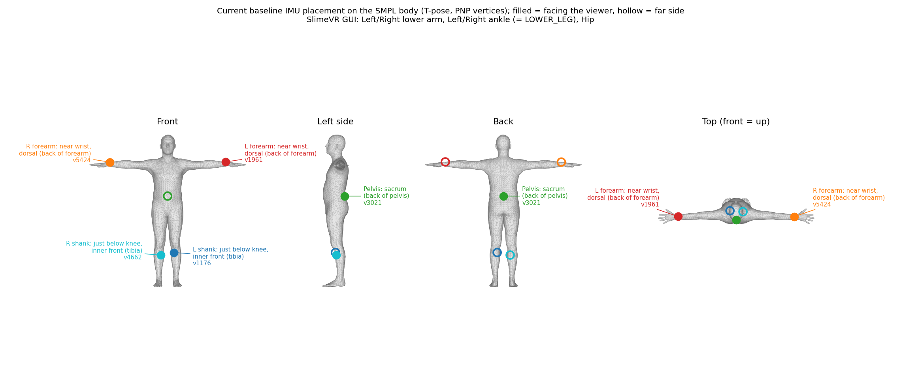

# 项目目标与当前状态

## 核心目标

使用五个 IMU 实时驱动 Unity Humanoid Avatar：

```text
Tracker 固件 → SlimeVR Server → SolarXR → production.run
→ MobilePose（SparseIMU 现行基线）→ ws://127.0.0.1:21200 → Unity Avatar
```

| SlimeVR BodyPart | MobilePose label | 佩戴位置（与训练数据一致，按 SMPL T 姿几何） |
|---|---|---|
| LEFT_LOWER_ARM | `lw` | 左前臂：肘→腕约 85–87% 处（靠近手腕），**背侧**（手背同侧） |
| RIGHT_LOWER_ARM | `rw` | 右前臂：同上 |
| LEFT_LOWER_LEG（界面：Left ankle） | `ls` | 左小腿：膝→踝约 25% 处（**膝下约四分之一**），**前内侧**（胫骨内侧面） |
| RIGHT_LOWER_LEG（界面：Right ankle） | `rs` | 右小腿：同上 |
| HIP（也接受 WAIST） | `pelvis` | **骨盆后侧/骶骨**，约在骨盆关节上方 10 cm；朝向取骨盆骨（不是旧的 spine1 腰前侧） |



（图：SMPL T 姿下五个传感器的位置，PNP 顶点；实心 = 朝向观察者一侧，空心 = 背面。由 `scripts/plot_sensor_placement.py` 生成。）

布局名为 `pnp5_forearm_shank_pelvis`，是唯一支持的布局。位置来自 SparseIMU 基线的 PNP 传感器顶点（前臂 1961/5424，小腿 1176/4662，骨盆 3021；`SparseIMU/mobileposer/configs/pnp_surface_imu.json`）。**旧位置（前臂外侧 75%、小腿外侧近踝、腰前侧 spine1、脚踝/足部）已经废弃**：对应的旧 30 fps 模型不再被实时程序加载。小腿传感器**不要**再戴在脚踝附近，也不要绑定 `LEFT_FOOT/RIGHT_FOOT`。

## 已完成

- SolarXR 自动识别布局与断线重连（单一布局，精确匹配）。
- 本地 SlimeVR 输出 reference-adjusted rotation 和 acceleration。
- MobilePose 实时推理：窗口 60 Hz 推进，默认每 2 帧推理一次（30 poses/s），91 帧窗口（过去 80 + 未来 10 帧），直立帧初始化窗口。
- 与 SparseIMU 基线逐帧数值一致性验证（最大差 5e-7，见 `07_模型与传感器位置同步_20261019.md`）。
- Web 可视化、录制、回放、精确 feature/SMPL 输出记录。
- Python 到 Unity WebSocket 与 Humanoid 重定向。
- 可选地面、anchor、关节限位和膝盖保护（足接触输出已移除，新基线没有接触头）。
- SlimeVR Server、native bindings、GUI 和 Electron 软件可本地构建。

## 当前实时决策

实时主流程固定使用 `referenceAdjustedLinearAcceleration`。Python 不再要求运动 150 帧拟合 heading，只采集自然直立姿态初始化历史窗口。`--calibration-frames` 仅为旧命令兼容保留，推荐为 `0`。

默认模型 `pnp5_60a_s42_ftr3`（SparseIMU 主基线：AMASS 合成预训练 + DIP 微调 + AMASS 回放×3）。可选恒等锚定版 `pnp5_60a_sc_ftr3`：被传感骨输出 = 测量朝向 ⊗ 小修正，DIP 角度更好、TotalCapture 更差、对 SlimeVR 标定偏差更敏感，真机上是否更好尚未验证。

## 当前主要瓶颈

- 五 IMU 无法直接观测髋、膝、肩、肘。
- 真机佩戴位置/SlimeVR 约定与训练数据（PNP 顶点、DIP/AMASS 合成）之间的域差异尚未在真机上评估。
- 跪、躺、手撑地等姿态具有强多解性。
- 模型固有 10 帧 @60 Hz、约 167 ms 延迟。

Python heading 与 Server adjusted 的同帧输出几乎一致，说明 heading 对齐不是当前明显误差的主要来源。
